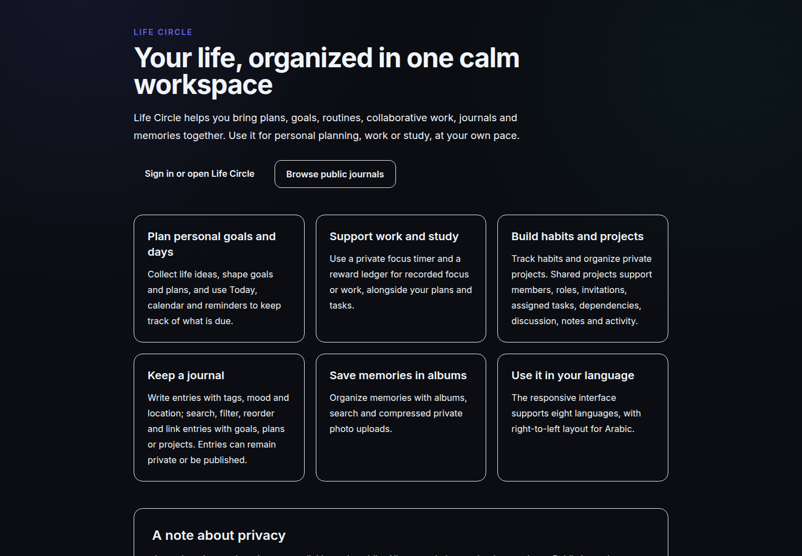
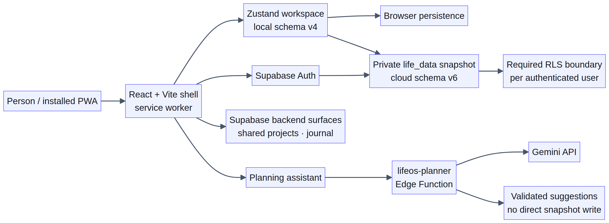
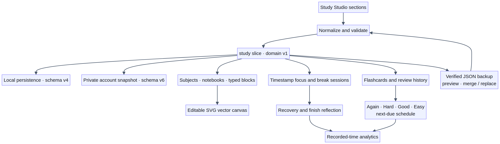

# Life OS System Handover Handbook

> **Evidence boundary.** This handbook distinguishes inspected source, local verification, and live deployment status. A clean TypeScript/Vite build and an isolated Study Studio smoke check (including 390 px mobile screens) passed on 2026-10-31. The live GitHub Pages deployment, deployed Supabase migrations/RLS, Edge Function, and production data behavior were not verified. Secrets, owner identity material, and private user data are omitted.

## 1. Executive overview

Life OS (with “Life Circle” still used in PWA metadata and backup filenames) is a React/TypeScript client built with Vite. Its application shell initializes auth, chooses hash-based app navigation or direct-path public pages, loads language resources, applies theme/direction metadata, and wraps private route content in a responsive `Layout`. Personal workspace state is held in Zustand under `life-os-v1`, local persistence schema version 4. Signed-in account snapshots use `life_data` with snapshot version 6; Study Studio is a private field in that snapshot, not a separate public table. A Supabase client is created only when the expected build-time URL and public anon key are configured.

Backend capabilities are delivered through ordered Supabase migrations, row-level security (RLS), narrowly granted RPCs, and the `lifeos-planner` Edge Function. Private productivity snapshots, shared collaboration records, public journal comments/publication, owner operations, and planner usage are separate data domains with distinct access paths. The SQL sources describe significant authorization controls, but the audits did not inspect a live project or confirm which migrations are deployed.

Release source describes GitHub Actions building the application, generating static public pages and a sitemap, copying the app shell to `404.html`, and publishing to GitHub Pages. A production-only service worker caches the shell and selected same-origin assets. Neither the current workflow history nor the live production site was verified.

### Non-goals and cautions

- This is not a security certification, migration-status report, live incident diagnosis, or proof of production correctness.
- It does not infer authorization from client routing, TypeScript types, hidden controls, comments, or menu configuration.
- It does not claim cloud-sync conflict resolution, background reminders, guaranteed offline operation, or completeness of translations/accessibility.
- It does not prescribe running ad hoc SQL, manually changing production accounts/data, or exposing credentials.

## 2. Layered architecture and repository map

### Runtime layers

1. **Static shell and build:** `index.html`, `vite.config.ts`, `package.json`; Vite bundles `src/`, then `scripts/prepare-public-pages.mjs` may generate public route HTML and `sitemap.xml` in `dist/`.
2. **Browser entry and app shell:** `src/main.tsx` adds the `js-enabled` document class, invokes `initAuth()`, registers the service worker in production after `window.load`, and mounts `<App />` under `React.StrictMode` into `#root`. `src/App.tsx` selects router mode, prepares theme/language, lazy-loads pages, and applies source-visible auth/routing decisions.
3. **Presentation and features:** `src/components/` contains `Layout`, shared controls and feature UI; `src/pages/` contains page modules. Layout provides desktop/mobile navigation, account/sync controls, QuickAdd, planner, command palette, and toast presentation.
4. **Client domain/state services:** `src/lib/` contains `store.ts`, `types.ts`, `study/`, `supabase.ts`, `auth.ts`, navigation/locales/reminders/media/admin/shared-project helpers and utilities. The personal store persists through Zustand middleware. `auth.ts` loads and writes the caller's `life_data` snapshot and subscribes to same-user realtime changes.
5. **Backend and data boundary:** `supabase/migrations/` defines database structures, policies, grants and RPCs; `supabase/functions/lifeos-planner/` implements planner requests. Public static generation also reads the configured public journal endpoint during CI.
6. **Release automation:** `.github/workflows/deploy.yml` builds and publishes GitHub Pages artifacts. `public/sw.js` supplies the production cache behavior.

### Key paths by responsibility

| Concern | Primary audited paths |
|---|---|
| Entry, routing, startup | `src/main.tsx`, `src/App.tsx` |
| Layout and global navigation | `src/components/Layout.tsx`, `src/lib/navigation.ts` |
| Personal state/contracts | `src/lib/store.ts`, `src/lib/types.ts`, `src/lib/utils.ts` |
| Supabase client/auth references | `src/lib/supabase.ts`, `src/lib/auth.ts` |
| Reminder computation | `src/lib/reminders.ts`; requested `src/components/ReminderScheduler.tsx` was absent |
| Feature pages | `src/pages/Today.tsx`, `Overview.tsx`, `Library.tsx`, `Goals.tsx`, `Habits.tsx`, `Projects.tsx`, `Calendar.tsx`, `Journal.tsx`, `Albums.tsx`, `Notifications.tsx`, `Productivity.tsx`, `AdminConsole.tsx`, plus public journal pages |
| Shared/admin UI | `src/components/projects/SharedProjectsWorkspace.tsx`, `src/components/admin/*` |
| Study Studio | `src/pages/StudyStudio.tsx`, `src/pages/StudyStudio.css`, `src/components/study/StudyNotebookEditor.tsx`, `StudyCanvas.tsx`, `StudyFocusWidget.tsx`, `src/lib/study/*` |
| Visual/localization system | `src/index.css`, `src/lib/locales.ts`, `src/lib/locales/{ar,bn,es,hi,ja,ko,zh}.ts`, `src/components/ui.tsx` |
| Database and planner | `supabase/migrations/*.sql`, `supabase/functions/lifeos-planner/index.ts` |
| Build/public generation/PWA | `package.json`, `vite.config.ts`, `index.html`, `scripts/prepare-public-pages.mjs`, `public/sw.js`, `.github/workflows/deploy.yml`, `README.md` |

The architecture diagram shows the source-level boundaries; it is not evidence that production migrations or runtime services are currently deployed.

The route registry is not equivalent to a route table: navigation metadata and feature links were audited, but the actual registration of all feature routes was not independently confirmed beyond the inspected `App.tsx` shell behavior.

## 3. Startup, authentication, and routing

### Startup sequence

1. Host HTML must provide `#root`; the entry uses `createRoot(document.getElementById('root')!)`, so a missing mount node can fail before React renders.
2. `main.tsx` marks JavaScript enabled and calls `initAuth()` before rendering the app under `StrictMode`.
3. In production only, service-worker registration waits for `window.load` and uses `${import.meta.env.BASE_URL}sw.js` with the same base as its scope. Registration errors are logged as a warning and do not block rendering.
4. `App.tsx` reads theme/language from the store. It removes known theme classes, applies its selected class behavior, sets document language, and sets `dir="rtl"` for Arabic. Language preparation gates rendering; a rejected preload falls back to English readiness.

### Router selection and route decisions

- Paths ending in `/about` or `/public` (including nested paths), after trailing slash trimming, select `BrowserRouter`; basename is inferred from the path prefix preceding the public route. `/about` renders `PublicProduct`; public journal paths are handled through the public route flow.
- Other entry paths use `HashRouter` for ordinary app navigation.
- `/study/*` is a private hash route rendered by `StudyStudio` inside the authenticated app shell; the active-session widget is mounted once from `Layout` and hidden on public pages.
- The public route flow recognizes `/public`, `/public/journal`, and `/public/journal/:slug`; unmatched public paths fall back to `PublicJournalIndex`.
- Other paths enter `PrivateRoutes`. When cloud mode is enabled, routes wait for auth readiness. Recovery with a session renders `SetNewPassword`; absent session with guest disabled renders `AuthPage`; otherwise the private route table is rendered inside `Layout`. With cloud mode disabled, those auth checks are skipped. Unknown private paths fall back to `Overview`.
- `RouteContent` reads an `invite` query parameter and attempts to persist it in session storage as `lifeos:pending-shared-invite`. If a session and marker are present, it redirects to `/projects` unless already there. Invite validation/consumption and marker clearing were not established.
- UI route checks are not backend authorization. RLS/RPC checks must remain authoritative.

### Navigation behavior

`Layout` starts from `DEFAULT_NAVIGATION`. If Supabase is available it reads `lifeos_menu_config` for key `navigation`, normalizes it, and listens for matching realtime changes. Invalid/missing/error results leave the built-in menu in place; productivity and notifications are retained if omitted. The normalized configuration allows safe routes and known icons, requires a visible boolean and nonempty trimmed labels up to 80 characters, and rejects an invalid candidate as a whole. `/admin` visibility depends on `useOwnerAdmin()`.

Sidebar, mobile drawer, primary bottom bar, keyboard shortcuts, and visibility filtering are separate presentation surfaces: inspect them together when changing navigation. Mobile drawer closes on navigation and Escape; `Ctrl/Cmd+K` toggles the command palette; a `g` then configured route letter within 800ms navigates unless focus is in an input, textarea, or select.

## 4. Frontend state, sync, and feature data flow

### Local store

`src/lib/store.ts` creates a Zustand store with persistence name `life-os-v1`, version `4`. State includes categories, items, goals, projects, habits, journal entries, albums, settings, trash, productivity focus sessions, reward events, and the separate `study` domain. Migration v2 adds missing default categories, v3 initializes trash, and v4 initializes empty Study data for older local snapshots. `updateStudy` normalizes each update; `importAll` also normalizes Study data. Browser persistence uses Zustand's default storage adapter: it is not application-level encrypted, and quota/corruption recovery is not implemented here.

Personal task records are `LifeItem`s, while private project tasks are nested `Task[]`; shared workspace tasks are a separate cloud domain. `LifeItem.goalId` and `Project.goalId` are reference links to goals, not embedded goal records. Goal deletion detaches linked records and records relation metadata for restoration. Private task dependencies are local to their project. Habit check-ins and focus completion create corresponding store updates/reward events.

`importAll` replaces collections using input/default behavior; `resetAll` resets to initial values; `loadDemo` populates through regular actions. These are consequential data operations and should only be invoked with explicit authorization and a backup.

### Cloud client versus sync

`src/lib/supabase.ts` exports a client only when both `VITE_SUPABASE_URL` and `VITE_SUPABASE_ANON_KEY` are present, with persistent PKCE auth options. On sign-in, `auth.ts` reads `life_data` by the current Auth user ID and upserts `{ user_id, data, updated_at }`; deployed RLS must enforce that boundary. Store changes are debounced for about 1.2 seconds. A revision loop repeats a write if more local changes arrive while it is in flight. The module reports offline/error/saved states, retries a pending write when the browser's `online` event fires, and subscribes to same-user realtime changes. It will not apply a remote change while this device has unsynced local revisions. This is not a persistent offline queue or a merge-based multi-device conflict resolver: simultaneous writes can still race, and one accepted snapshot can replace another device's changes.

The local key `life-circle-owner` distinguishes same-account data from data previously loaded by another account. On account change, the store is reset before remote data is applied. If a legacy cloud snapshot lacks a valid `study` object, local Study data is preserved only when that owner marker matches the same user, then the upgraded snapshot is written. Signing out flushes a sync attempt before clearing this account's local workspace. These are source behaviors; deployed RLS and remote durability still require environment verification.

### Reminder and notification boundary

`collectReminders` computes in-memory reminders: eligible unfinished items/tasks, active goal dates, and habit check-ins in a seven-day window (including some undated items/tasks). `reminderTiming` classifies timing only. It does not send notifications. Feature source indicates optional browser alerts are checked while the Notifications page is open and locally deduplicated per day; this is not background scheduling. The specified `src/components/ReminderScheduler.tsx` was not present, so no scheduler, permission prompt, polling, push, or delivery behavior can be asserted.

## 5. Backend schemas, RLS, RPCs, and Edge Function

### Migration discipline and deployment uncertainty

Audited migrations, in filename order:

1. `20261021_public_journal_comments.sql`
2. `20261021_owner_admin_tools.sql`
3. `20261023_shared_projects.sql`
4. `20261024_private_productivity_admin_shield.sql`
5. `20261024_productivity_navigation.sql`
6. `20261024_public_comment_author_privacy.sql`
7. `20261024_shared_workspace_upgrade.sql`
8. `20261026_owner_account_list_repair.sql`
9. `20261026_planner_usage.sql`

Apply through the repository's normal migration mechanism in a non-production project first. Do not edit already-applied history or use manual production SQL as a substitute for reconciling migration history. The shared workspace upgrade depends on the shared-project base migration; navigation migration documents its dependency on owner tools; owner repair assumes core helper/schema relations. Some migration comments describe additive/rerunnable behavior, but the shared base intentionally does not replace same-named policies on rerun. Check migration ledger and actual catalog before any repair. No live migration status was inspected.

### Data domains and authorization patterns

- **Private snapshot:** `life_data` is the personal JSON snapshot referenced by auth/admin flows. Base schema and live RLS were outside the audit scope; do not treat source comments as proof of deployed enforcement.
- **Owner operations:** `lifeos_is_owner_admin()` is a `STABLE SECURITY DEFINER` function with empty `search_path`, checks the authenticated account and confirmed-email condition, and is granted to authenticated rather than public/anon. The identifying matcher is deliberately omitted. Owner RPCs independently call this helper. Snapshot editing is an optimistic update to an existing row, requires object JSON, caps payload at 1 MiB, and uses `expected_updated_at`; it does not create missing snapshots. Owner audit data has constrained actions/object metadata and forced RLS. Navigation config is publicly readable but written through the owner-guarded validator RPC.
- **Public comments:** anonymous/authenticated reads expose selected public fields. Inserts require the authenticated author identity and an existing journal. Deletion is limited to author, journal owner, or verified owner-admin. A later migration revokes authenticated author-ID column access and adds a scoped deletion-ID RPC.
- **Shared collaboration:** project, member, task, dependency, comment, note, activity, invitation, private-link, notification, and portfolio tables use role-aware helpers and RLS. Project lead/admin can manage; lead/admin/member/guest can work; viewer is excluded from work. Membership and `auth.uid()` checks are central. Dependencies are same-project; assignees must be members. Shared project lifecycle and portfolio changes use guarded RPCs. Invitation plaintext is returned through the intended flow while only SHA-256 digest is stored; invitation selection does not expose digest. Portfolio membership does not itself grant project access. Private task links are per-linking-user and separate from private snapshot JSON.
- **Planner quota:** `planner_usage` retains only per-user UTC-day counts, caps at 20, forces RLS, and has no authenticated table grants. `consume_planner_request()` validates caller identity and serializes per-user/day increments with an advisory transaction lock.

### Planner function

`lifeos-planner` accepts POST/OPTIONS, validates the bearer token through Supabase Auth using a user-scoped client, validates request shape/language/date/timezone and 1–6 bounded turns, rejects detected sensitive input, consumes quota, calls the external Gemini API, normalizes/validates proposals, and returns suggestions without writing snapshots. Runtime variables are required for Supabase URL plus anon/publishable key and Gemini credentials; values must never be printed. Source-declared response classes: 401 auth/config, 400 request validation, 422 sensitive-input rejection, 429 quota, 503 missing model key/quota RPC unavailable, 502 upstream/network/model failure.

## 6. Feature module cross-links

- **Overview and Today:** Today manages immediate LifeItems and habit check-ins. Overview aggregates pinned/due items, active habits, goal progress, and assigned shared tasks, linking to Today, Habits, Goals, and Projects.
- **Library and QuickAdd:** Library/ItemEditor manage LifeItems; QuickAdd creates different entity types according to context. Items feed Today, Calendar, Notifications, Productivity and reminder calculations.
- **Goals:** Goals own milestones and link to items/projects through IDs. Calendar and Overview derive goal progress; Planner may use related context. Preserve detach/restore behavior when modifying relations.
- **Habits:** Habit logs drive streak/adherence and reminder check-ins; check-ins can award a unique reward for a habit/date.
- **Projects:** Private projects hold nested tasks/dependencies in the personal store. Shared projects are separate cloud records managed by `SharedProjectsWorkspace`; copying private work to shared may be partial and does not automatically copy private goal association. Shared task-to-goal/habit links are private per user.
- **Calendar and Notifications:** Computed views over items, goals/milestones, projects/tasks and habits, not separate event records. Shared assigned tasks are fetched from collaboration services.
- **Productivity:** Selects eligible private items and private-project tasks; completed focus sessions enter store and can produce rewards. Timer config uses separate localStorage key `life-os-pomodoro-config-v1`; timer-running state is component state.
- **Study Studio:** A separate private learning domain provides subject/course/book/chapter/topic hierarchy, structured notebook pages, vector canvases, timestamp-based focus sessions with recovery/reflection, flashcards with graded review history, preferences, and analytics. It does not reuse the general productivity focus-session model.
- **Journal and public pages:** Local `JournalEntry` state and backend `public_journals` lifecycle are distinct. Publish/unpublish/delete is explicit; a failed backend operation prevents the local transition. Public comment policies are distinct from journal publication.
- **Albums/media:** Album memories reference private media paths rendered through signed URL helpers, with legacy external URL fallback. Do not expose object paths or signed URLs. Record trash restoration does not prove binary retention.
- **Admin:** UI is gated through `useOwnerAdmin()` and sensitive RPCs enforce authorization again. Account listing, audit, navigation editing, metrics and selected snapshots are administrative data; never include user-specific contents in routine handover/logs.

## 7. Design tokens, responsive behavior, localization, accessibility

### Visual system and responsive rules

`src/index.css` combines Tailwind layers with reusable classes (`.card`, `.btn-primary`, `.btn-ghost`, `.btn-outline`, `.btn-danger`, `.input`, `.label`, `.chip`, `.muted`). The audited styles are mainly utility classes and literals rather than a centralized token map. Modes include default/light, `html.dark`, and `html.theme-forest`; palette families include indigo/purple accents, slate neutrals, rose danger, emerald success, and forest greens.

At max-width 1023px, mobile header/drawer/bottom-nav spacing applies. At max-width 640px, form controls use 16px text and safe-area-aware padding. Components use additional Tailwind breakpoints. Study Studio uses a horizontally swipeable one-row section rail on mobile; Focus Room portals to a viewport-filling layer, hides the ordinary shell while open, and provides an explicit exit route. The SVG timer display keeps integer `hh:mm:ss` on one line. Study routes were smoke-tested at 390 px; still test 320–375px widths, desktop, long translations, 640/1023px boundaries, and safe-area devices. Preserve `min-w-0`, wrapping/breaking safeguards, and mobile-first layouts. Global horizontal overflow hiding may mask clipping rather than solve its cause.

### Language and direction

Available language codes are English, Chinese, Japanese, Korean, Bengali, Hindi, Arabic, and Spanish. Seven non-English dictionaries load dynamically; English returns the source string. Translation is exact-key lookup and missing entries silently fall back to English. The selected dictionary must be preloaded before translated calls; the locale helper itself does not trigger a rerender. Arabic metadata declares RTL; the app shell audit confirms it sets document direction for Arabic, but broader layout mirroring/logical CSS was not established. Add new phrases using complete source strings and update all seven dictionaries; verify punctuation/case and dynamic phrase construction.

### Accessibility and motion

Global `prefers-reduced-motion` overrides are present. Some components provide semantic labels/roles, progress semantics, keyboard/touch/pointer sorting, and non-drag reorder buttons. Modal source supports dialog labeling, Escape and backdrop close, but a focus trap and focus restoration are not confirmed. Do not assume all icon-only controls are named. Verify focus order, screen-reader names/announcements, contrast, zoom, keyboard operation, and drag alternatives for the specific changed control; no runtime accessibility testing was performed.

## 8. PWA, SEO, build, and release

### Build and publish pipeline

`package.json` scripts include `dev` (`vite`), `build` (`tsc -b && vite build`), and `preview` (`vite preview`). No test, lint, deploy, or SEO-preparation script is defined there. The audited workflow uses Node 20 and `npm install`, runs the build, invokes `node scripts/prepare-public-pages.mjs`, copies `dist/index.html` to `dist/404.html`, configures Pages, uploads the artifact, and deploys. README documents GitHub Actions variables for public Supabase URL/anon key. The workflow contains public fallback configuration, so absent repository variables do not necessarily halt build/static generation.

Vite `base` is `./`; `index.html` contains a `/life-os/` base href; the SEO generator includes fixed Pages origin/path links; service worker derives registration path/scope from `import.meta.env.BASE_URL`. These settings must be reviewed together on repository/path/domain changes. Build output rewriting was not inspected, and correctness must be verified from actual `dist` and the served deployment.

### Static SEO generation

The preparation script writes about/public/public-journal pages, optional article pages, and sitemap. It enumerates public journal rows in pages up to 1,000, stops at 50,000, deduplicates, accepts only safe slugs, and generates at most 1,000 article pages. Content is escaped/truncated; article JSON-LD and canonical/robots metadata are generated. Failure to enumerate degrades to hub URLs; detail failures can leave query-form URLs. About/public hubs and generated pages are indexable; generic journal route remains noindex. These are source behaviors, not proof of current endpoint permissions or live SEO output.

### Service worker

`public/sw.js` uses cache `life-circle-static-v2`, best-effort shell precache, deletes older `life-circle-static-*` caches on activation, then claims clients. Same-origin GET navigations are network-first; successful no-query responses are cached. Offline fallback tries exact cached page then shell. Query-bearing navigation is not stored and does not use exact-page fallback. A narrow set of assets uses cache-first with background refresh. REST/Auth/Storage APIs and other origins are bypassed. This is not a general offline data cache. Cache version changes should be deliberate and tested against upgrade/storage behavior.

### Production verification (local checks completed; live deployment pending)

The local production build and Study smoke checks passed on 2026-10-31. After a release, still verify GitHub Actions build/deploy jobs and the live URL; inspect generated `dist` routes, assets, `404.html`, sitemap, and metadata; test hash navigation, direct `/about` and `/public` links, repository basename, query/hash handling, service-worker registration/scope, and fresh/offline/upgrade behavior in a production browser. This pass did not query the live deployment or confirm current Supabase migration status. The source comment about GitHub Pages serving `404.html` is not independently verified.

## 9. Operator troubleshooting playbook

### Startup and navigation
- **Blank page before app shell.** **Diagnose:** Check console for missing `#root`, entry/chunk failure, or JS error. **Safe fix:** Restore expected host mount or correct asset/base configuration; avoid changing auth/data to address a mount failure. **Verify:** Load root and direct public URLs; confirm React mounts and no console startup error.
- **Stuck on secure-session loading.** **Diagnose:** In cloud-enabled mode, auth readiness has not resolved. Inspect auth state/initialization and network; implementation details were not fully audited. **Safe fix:** Diagnose auth initialization/configuration without bypassing session checks. **Verify:** Exercise cloud on/off, not-ready, no-session guest false/true, recovery with session, and invite with session.
- **Unexpected login or password-reset page.** **Diagnose:** Apply the source routing decision: recovery session precedes regular routes; absent session plus guest false routes to AuthPage. **Safe fix:** Correct the underlying auth state/configuration, not the route guard as a workaround. **Verify:** Repeat the relevant session/recovery case and verify backend authorization separately.
- **Route shows Overview unexpectedly.** **Diagnose:** Unknown private paths fall back to Overview; unknown public paths fall back to public index. **Safe fix:** Check route registration and link spelling; add explicit route only after confirming intended fallback. **Verify:** Open exact path directly and navigate from menu; confirm no accidental fallback.
- **Page chunk fails to load.** **Diagnose:** Inspect network/console for lazy chunk 404, stale worker asset, or deployment base mismatch. **Safe fix:** Correct build/deployment asset paths; do not assume the loading fallback is an error boundary. **Verify:** Hard refresh/clean deployment test and navigate directly to lazy page.
- **Language stays English or stalls.** **Diagnose:** Check language code, dictionary loader/key, preload completion, dynamic import failure and rerender. **Safe fix:** Correct exact translation key/loader and ensure preload lifecycle is handled. **Verify:** Test selected language after load, missing-key fallback, and a long localized label.
- **Navigation item missing/stale.** **Diagnose:** Check default route allowlist, remote value shape, known icon, visibility, length, Supabase query and realtime. **Safe fix:** Restore built-in config or publish valid navigation through authorized owner flow; do not widen route acceptance casually. **Verify:** Confirm desktop/mobile visibility, root exact matching, primary bottom bar, keyboard navigation, and owner-only admin visibility.

### Data, access, and collaboration
- **Personal data mismatch.** **Diagnose:** Distinguish persisted local store (`life-os-v1`, v4), the account marker, and cloud snapshot version 6. Check sync status/error and current account; never copy localStorage contents into logs. **Safe fix:** Back up with fresh account verification; test migrations on a redacted copy; use supported refresh/export/reset only with explicit authorization. **Verify:** Test cold start/local migration, same-account restore, account-switch clearing, and sync in the intended Supabase project. Cloud conflict behavior is not merge-based.
- **Cloud operations unavailable.** **Diagnose:** Check presence (not values) of both browser environment settings, auth state, network and caller error. **Safe fix:** Correct intended build configuration or restore connectivity; never introduce a service-role key in client configuration. **Verify:** Confirm client initialization in the intended environment and test a least-privilege operation.
- **Owner console denied / account list RPC mismatch.** **Diagnose:** Hook treats errors/non-true as false; check confirmed session and exact installed three-argument list RPC/schema cache. **Safe fix:** Reconcile migration history and apply approved repair migration in the intended project; refresh schema cache when appropriate. **Verify:** Verify exact RPC signature and permission behavior for authorized and unauthorized test accounts.
- **Snapshot save returns changed/not found.** **Diagnose:** `expected_updated_at` mismatch is concurrency protection; missing snapshot is intentionally not inserted. **Safe fix:** Reload target and retry with current timestamp; do not blind-upsert. **Verify:** Confirm updated value and audit event; verify stale timestamp is still rejected.
- **Shared project permission/schema error.** **Diagnose:** Check membership/role, authenticated identity fields, project migration sequence, and schema cache. **Safe fix:** Apply missing migrations through migration runner in non-production first; correct membership via authorized RPC. **Verify:** Test allowed and denied roles, cross-project references, viewer read-only, invitation reuse/expiry, and portfolio-project membership rule.

### Feature operations and release
- **`/about` or `/public` fails while hash app works.** **Diagnose:** Distinguish direct BrowserRouter path, inferred basename, Pages fallback, and emitted asset paths. **Safe fix:** Reconcile Vite base, HTML base, SEO links, worker scope, and host path as a set. **Verify:** Test exact deployed URL forms, direct refresh, root mount, nested public route, basename, and query/hash behavior.
- **Planner status 401/400/422/429/503/502.** **Diagnose:** Interpret as auth/config, request validation, sensitive input, quota, missing runtime dependency, or upstream failure respectively. **Safe fix:** Correct request/config or wait for quota; inspect configuration by presence only. Do not bypass validation, quota, or user-scoped auth. **Verify:** Test representative valid/invalid calls and verify no snapshot persistence and no sensitive values in logs.
- **Reminder missing or unexpected.** **Diagnose:** Check local date, `YYYY-MM-DD` values, done/dropped/paused/archive status, seven-day window, and habit frequency/log. **Safe fix:** Correct source record/date or reminder calculation deliberately; no delivery fix can be prescribed for absent scheduler file. **Verify:** Verify computed reminder result and, separately, alert behavior only while Notifications is open.
- **Journal publish/unpublish problem.** **Diagnose:** Compare local journal state and backend publication operation; verify explicit publish/auth/connectivity. **Safe fix:** Retry supported publish flow only after checking outcome; do not mark locally public when backend operation failed. **Verify:** Verify public URL and removal behavior in a controlled account; do not expose private journal content.
- **Album photo blank.** **Diagnose:** Check `imagePath` versus legacy `imageUrl`, signed URL helper, ownership/access, and storage response. **Safe fix:** Re-resolve signed URL or use supported media replacement; never publish private paths/URLs. **Verify:** Verify upload/replace/remove/trash/restore with authorized test media.
- **Offline/stale assets.** **Diagnose:** Check service-worker registration, cache name/path, quota/storage and network. Selected assets may return cached content then refresh. **Safe fix:** Clear site data only as a deliberate recovery; bump cache version only when intentionally invalidating generation. **Verify:** Test online, offline, update activation, query navigation, and storage-denied behavior.
- **Publish workflow fails.** **Diagnose:** Inspect checkout/setup → install → build → SEO preparation → 404 copy → Pages configuration → artifact upload → deploy. **Safe fix:** Fix first failing stage; treat SEO warnings separately from failed jobs. **Verify:** Verify workflow run, artifact, published URL, direct routes, sitemap, assets and worker after deploy.

## 10. Safe change workflow

1. **Scope the data and boundary.** Identify whether a change affects local `LifeItem`, nested private task, shared task, public journal, private media, navigation config, or admin data. Identify UI route and actual backend callers. Do not infer server authorization from UI/types.
2. **Edit the appropriate sources together.** For a state contract, update `src/lib/types.ts` or `src/lib/study/types.ts`, store defaults/actions and a versioned `migrate` in `src/lib/store.ts`, then all derived selectors/forms/pages. Keep the local store version (currently 4), Study domain version (currently 1), and cloud JSON snapshot version (currently 6) distinct. For routing/startup, update `src/main.tsx`/`src/App.tsx` and exercise hash/direct paths. For navigation, update type/icon registry/default list/safe route validation in `src/lib/navigation.ts`, Layout surfaces, and admin publication as applicable. For locale text, update source key and all dictionaries. For database behavior, add a new migration rather than editing applied history, and preserve RLS, grants, `search_path`, caller checks and intended RPC roles.
3. **Review downstream links.** Follow feature links in Section 6. Check trash/restore, relations, reminders, Calendar, Notifications, Productivity, public visibility, signed media, shared task private links and owner operations where relevant.
4. **Test locally using repository-supported commands.** Run `npm install` and `npm run build` (TypeScript build then Vite). `npm run dev` supports interactive checks. The audits did not establish test/lint scripts or a test suite, so do not invent command names. Add/use tests only if repository setup supports them.
5. **Test behavior matrices.** For auth routing test cloud enabled/disabled, readiness, session/guest combinations, recovery and pending invite. For navigation test desktop/mobile, malformed config fallback, keyboard, root exact match, translation and owner visibility. For data changes test cold start, local versions 1–3 migration, import/reset only with fresh verification, persistence reload, and redacted migration fixtures. For Study changes also test legacy cloud snapshots without `study`, nested backup merge, vector normalization bounds, and active-session recovery. For responsive/locale changes test narrow widths, language preload, theme variants, Arabic direction, keyboard and reduced motion.
6. **Migrate and deploy cautiously.** Review ordered migration dependencies and current migration ledger in the intended Supabase project. Apply to non-production first; test allowed and denied paths with least-privilege accounts and anonymous requests where relevant. Confirm PostgREST signatures/cache after RPC signature changes. Deploy Edge Functions separately: README says the Pages workflow does not deploy them.
7. **Verify production explicitly.** Follow Section 8 production checklist. Verify the actual Pages artifact, routes, generated metadata, service worker, Supabase target and migration state. A successful source build alone is not production verification.
8. **Rollback plan.** For frontend, retain the previously published artifact/commit and use the repository's approved deployment rollback path; verify routes and worker after rollback. For database changes, do not assume a migration is safely reversible: plan a reviewed forward-fix or explicit rollback migration, preserve data, and rehearse in non-production. For store schema changes, retain migration compatibility with existing v4 persisted snapshots and backup before destructive import/reset. Never use live personal records as a test fixture.

## 11. Credentials, secrets, and privacy boundaries

- Browser variables `VITE_SUPABASE_URL` and `VITE_SUPABASE_ANON_KEY` are build-time configuration; the anon key is public by design, not a substitute for RLS. Do not place service-role credentials or private server keys in `VITE_*`, static artifacts, browser logs, or this handbook.
- Edge Function runtime configuration includes Supabase URL and anon/publishable key plus model credential. Inspect presence/status without printing values. External model inputs are validated and sensitive-input detection exists, but no external model privacy assessment was performed.
- The owner authorization matcher is deliberately omitted. Do not copy owner identity material into documentation or logs; use approved access procedures.
- Treat `life_data`, local persisted store, journal content, signed media URLs/object paths, shared invitations, account directory results, and selected admin snapshots as private. Avoid collecting or logging raw account snapshots, invitation material, private URLs, credentials, or user records during troubleshooting.
- Public journal comments and public journal publication are distinct. Publicly readable fields and author-ID privacy controls do not make private journal entries public automatically.
- Client-side route guards/menu visibility are presentation controls. Database grants and RLS/RPC checks must be preserved and verified independently.

## 12. Confirmed limitations and audit gaps

- No live Supabase project, migration history, RLS catalog, Edge Function deployment, provider logs, Pages settings, Actions run, deployed artifact, or production browser was inspected.
- Live base schema/policies, media bucket policies, deployed RLS, actual multi-device conflict outcomes, locale preload caller lifecycle, service-worker runtime outcomes, host HTML, and live route registration remain unverified. Source-level sync behavior is described in Section 4.
- `src/components/ReminderScheduler.tsx` was missing at the requested path. Reminder computation is confirmed; background scheduling and delivery are not.
- Public-page static generation has explicit limits (50,000 enumerated rows, up to 1,000 generated article pages, safe-slug filtering) and relies on configured endpoint behavior not independently verified.
- The release source has multiple path/base settings (`./`, `/life-os/`, fixed site URL, service-worker base). Only generated output and a live deployment can prove they align.
- Unknown routes silently fall back to Overview or public journal index in the inspected shell.
- Translation coverage/quality, contrast, focus trapping/return, screen-reader behavior, browser storage quota/corruption handling, media retention on trash, and complete offline functionality were not validated.
- A clean TypeScript/Vite production build passed on 2026-10-31. An isolated production preview was smoke-tested for Study Overview, focus timing, subject/course CRUD, notebook/page/block creation, and vector-canvas mounting, including 390 px screenshots. No automated test suite, full end-to-end test, security assessment, accessibility audit, or live deployment verification was performed.

**Handover rule:** treat all operational conclusions as source-confirmed behavior until the corresponding deployment, migration, and runtime checks have been performed and recorded in the intended environment.

## 13. Study Studio: data contracts and interaction flow

Study Studio is a private learning workspace. It is an authenticated route and does not add a database table. Its state lives under `useStore.study`, persists with the main `life-os-v1` browser snapshot, and is included in the version-6 `life_data` account document. The feature contract is `StudyData.version: 1`; do not confuse that domain version with the local store migration version 4 or cloud/backup version 6.

### Domain model

`src/lib/study/types.ts` defines subjects, courses/books, chapters, topics, notebooks/pages/blocks, SVG canvases, active and completed study sessions, flashcards/review history, and preferences. Notebooks contain ordered pages; each page can hold paragraph, heading, checklist, code, callout, quote, formula, and divider blocks. Canvases can link to a notebook and page. Flashcards keep current scheduling state and append graded review history.

The pure timer and spaced-review logic lives in `src/lib/study/engine.ts`. Focus and break intervals use ISO timestamps rather than depending on a background interval. Pause closes the current segment; resume starts a new one. Breaks have an explicit end timestamp. Recovery closes the prior open interval and presents a resume-or-discard choice; resume starts a new segment, so downtime is not counted as focus. Finishing records focus and break seconds plus an optional reflection (covered material, confidence, outcome, unfinished work, and next note). This tracks recorded app sessions, not attention or system-wide phone usage.

Spaced review uses Again, Hard, Good, and Easy grades. The scheduler updates repetition count, ease, interval, next due time, and card review history. Analytics aggregate completed focus time and review grades from saved records; they do not infer activity outside Life OS.

### Notebook and vector canvas

`StudyNotebookEditor.tsx` debounces text-block persistence, flushes pending edits before structural changes/unmount, supports page creation/duplication/order, typed block creation, and Markdown export. When a page is deleted, its linked canvases are reassigned to a remaining page. Notebook/page deletion uses in-app confirmations. Markdown export is a convenience export, not a complete notebook backup.

`StudyCanvas.tsx` renders SVG and persists normalized vector objects; it does not draw into a raster `<canvas>`. Supported objects are freehand strokes, lines, arrows, rectangles, ellipses, and text. Paper backgrounds are plain, grid, dot, or lined. Undo/redo is bounded in component memory; persisted state is the vector object list. Erasing removes intersected vector objects. Export serializes `.svg`. The current UI caps drawings at 1,200 objects, 30,000 vector points total, and 3,000 points per stroke; undo/redo retains at most 80 steps. Keep the UI and `normalizeStudyData` bounds in sync if changing those limits.

### Persistence, import/export, and privacy

`updateStudy` and `importAll` pass Study through `normalizeStudyData`, which supplies defaults, filters malformed blocks/objects, clamps normalized points, and bounds preferences. Older local snapshots at versions 1–3 gain empty Study data in migration v4. For a legacy cloud snapshot without a Study object, sync preserves local Study only when the local account marker matches the signed-in user, then writes an upgraded snapshot.

Settings JSON exports contain `study` and snapshot version 6. Backup actions require sign-in and fresh provider verification, then show an import preview and explicit merge/replace options. Merge matches records by ID and merges nested notebook pages/blocks, canvas objects, and flashcard review history; omitted Study collections are preserved. Replace replaces supplied collections, so an older backup without `study` may reset Study to empty defaults. CSV export covers Life Library items, not Study notebooks/cards. Never use a real private account backup for QA or logs. Browser local storage is not encrypted by application code; cloud privacy depends on deployed per-user RLS.

### Route, focus widget, and theme

The sections are Overview, Focus, Subjects, Notebooks, Practice, Revision, Analytics, and Settings. `src/lib/navigation.ts` registers Study Studio; `Layout` mounts one global `StudyFocusWidget` for private shell routes and hides it on public routes. Its one-second render interval is active only while a session exists. The widget offers pause/resume, break-end, return-to-Focus, and finish/reflection entry points. Entering the Focus route starts a timestamp session if none exists. The Focus Room portals to the document root and covers the normal shell; browser-native fullscreen is optional. The mobile section rail is horizontally swipeable. Keep contrast aligned to selected app theme and respect reduced-motion preferences.

### Study maintenance checklist

When adding a Study record type, update its model, empty-state factory, normalizer, store update paths, import merge policy, JSON export inclusion, analytics if applicable, and translations in all eight supported languages. Test old local snapshots, a legacy cloud snapshot without `study`, same-account sync, account switching, backup merge/replace, reload/recovery, and narrow mobile layout. Do not rasterize saved drawing content; it must remain editable vector data.

## 14. Desktop and Android distribution readiness

The live PWA manifest is `https://abdullahbinfahad.github.io/life-os/site.webmanifest`; it uses a project-site scope under `/life-os/`. The parity approach is to reuse the existing hosted app and Supabase backend rather than fork its React UI. Electron can host the HTTPS app in a hardened window; a TWA wraps the same PWA through a supported browser. Bubblewrap can generate an Android wrapper from the PWA manifest once application identity and signing inputs are settled [3]. This preserves one web feature source but does not remove network dependence for uncached resources.

An Electron wrapper must load only the expected HTTPS origin, disable Node integration for remote content, enable context isolation and sandboxing, restrict navigation/new windows, and grant permissions narrowly. Google installed-app guidance calls for a system browser and PKCE; Google sign-in should not run inside an embedded renderer [6]. A custom protocol callback and a matching Supabase Auth redirect allowlist are required for OAuth [7] [8]. Email confirmation and password-recovery callback paths also need end-to-end testing before desktop auth is called complete. Electron security recommendations are documented by the project [4].

A verified full-screen Android Trusted Web Activity needs a stable application ID, a release signing key, and a Digital Asset Links statement served at the origin root: `https://abdullahbinfahad.github.io/.well-known/assetlinks.json`. That URL is outside `/life-os/`. At the time checked, no readable file was served there, and the current GitHub authorization did not resolve an `abdullahbinfahad.github.io` repository. A project-site asset cannot by itself host the origin-root statement. Without the statement or a matching certificate fingerprint, the browser falls back to a Custom Tab with browser UI [1] [2]. Keep signing material out of source control; the statement must match the release key's SHA-256 fingerprint.

**Release status:** no signed APK, verified TWA, or Electron installer is claimed. Before public Android distribution, freeze the package ID, establish owner control of a persistent release signing key, and provide a host for the origin-root association file. Before desktop is feature-complete, implement and test system-browser sign-in callbacks, email confirmation, password recovery, and secure external navigation, then package and install-test each target OS. Code signing/notarization credentials remain separate owner-controlled secrets.

## References

[1]: https://developer.android.com/develop/ui/views/layout/webapps/guide-trusted-web-activities-version2 "Android Developers Trusted Web Activities Quick Start Guide"
[2]: https://docs.github.com/en/pages/getting-started-with-github-pages/about-github-pages "About GitHub Pages"
[3]: https://github.com/GoogleChromeLabs/bubblewrap/blob/main/packages/cli/README.md "Bubblewrap CLI"
[4]: https://www.electronjs.org/docs/latest/tutorial/security "Electron Security Recommendations"
[5]: https://www.electronforge.io/ "Electron Forge"
[6]: https://developers.google.com/identity/protocols/oauth2/native-app "Google OAuth 2.0 for Desktop Apps"
[7]: https://supabase.com/docs/guides/auth/redirect-urls "Supabase Auth Redirect URLs"
[8]: https://supabase.com/docs/guides/auth/native-mobile-deep-linking "Supabase Native Deep Linking"
